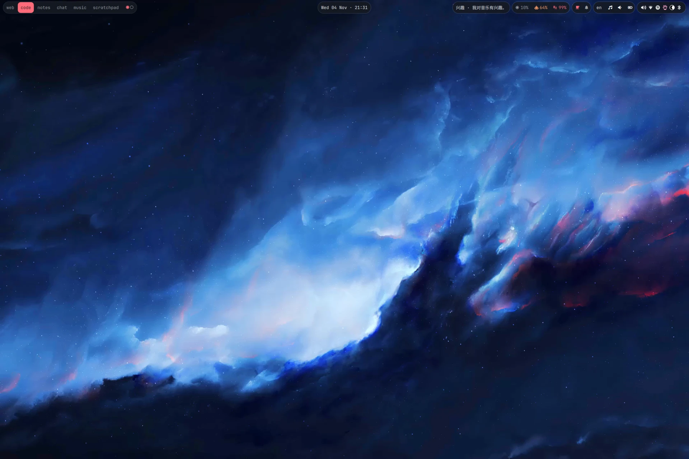

# dotfiles-nix

My NixOS and Home Manager configurations for personal workstations, laptops, and servers. The desktop uses Niri, a custom Quickshell bar, and Stylix, with shared modules for development tools and self-hosted services.

These are personal configurations, not an installation template. Hardware settings, accounts, secrets, and some dependencies are specific to my machines.

## What's here

- **Desktop:** Niri, Quickshell, Vicinae, Ghostty, and Fish.
- **Development:** Neovim through Nixvim, Helix on the PC, Rust tooling, and Git worktree tools.
- **Applications:** Home Manager modules for application settings, desktop entries, and user services.
- **Services:** Host-specific services, including Navidrome and backups.
- **Packages:** Custom derivations and overlays for tools that need local packaging or patches.
- **Secrets:** Age-encrypted files managed with agenix.

## Start reading

- [Framework configuration](hosts/framework/default.nix) and [PC configuration](hosts/pc/default.nix): which programs and services are enabled.
- [Niri](modules/system/desktop/niri/) and [Quickshell](modules/home/programs/quickshell/): the desktop and bar.
- [Home Manager modules](modules/home/): application and shell configuration.
- [System modules](modules/system/): hardware, desktop integration, and services.
- [Custom packages](pkgs/) and [overlays](modules/overlays/): package definitions and wiring.

[Host definitions](hosts/default.nix) export `framework`, `pc`, `desktop`, `travel`, and `raspi`. The [flake](flake.nix) also exports a standalone `not-matthias@jetson` Home Manager configuration. `pc` and `desktop` are separate targets.

## Using these configs

For your own machine, copy the modules you need or adapt a host first. Review hardware, filesystem and boot settings, the username, secrets, and network configuration before activating anything. Some flake inputs use authenticated SSH, and some applications require separately obtained release files or licenses.

For an already configured Framework machine, run these from the repository root:

1. Build without activation: `sudo nixos-rebuild build --flake .#framework`.
2. Apply the configuration: `sudo nixos-rebuild switch --flake .#framework`.

Use the target for your machine. To update dependencies, run `nix flake update`, review the lockfile changes, then build before switching.

## Further reading

- [Maintenance](docs/maintenance.md): host setup, Jetson, updates, garbage collection, and secrets.
- [Troubleshooting](docs/troubleshooting.md): evaluation failures, the desktop bar, and Timeguard recovery.
- [Package notes](pkgs/README.md) · [Pinned versions](PINNED_VERSIONS.md) · [Service ports](PORTS.md)

## Inspiration

- [MatthiasBenaets/nixos-config](https://github.com/MatthiasBenaets/nixos-config)
- [yrashk/nix-home](https://github.com/yrashk/nix-home)
- [Th0rgal/horus-nix-home](https://github.com/Th0rgal/horus-nix-home)
